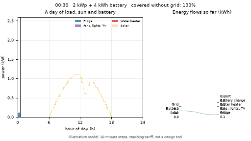
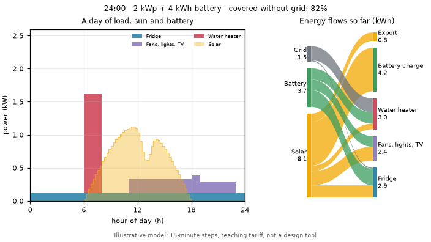
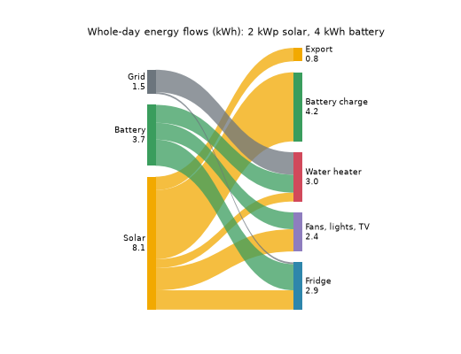
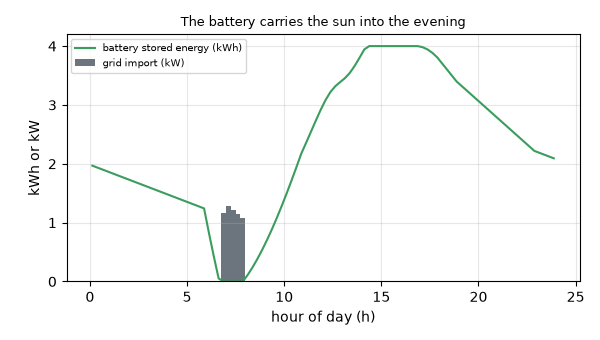
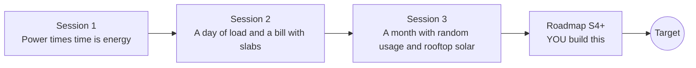

# openhousehold

[](https://github.com/KrunalPanchal1995/openhousehold/actions/workflows/ci.yml)   [](https://colab.research.google.com/github/KrunalPanchal1995/openhousehold/blob/main/sessions/session-01/lesson.ipynb) [](https://krunalpanchal1995.github.io/openhousehold/)

**Predict your home's electricity bill, and see where every kilowatt-hour goes.**

openhousehold teaches how a household uses electricity: from power times time, to a 24-hour load profile and slab tariff, to a month of random usage with rooftop solar and net metering, using only Python and a browser.

- **Start from zero.** Session 1 needs only multiplication: power times time is energy.
- **See it move.** Every session ships a slider app that runs in the browser, with labelled graphs.
- **Know you got it right.** Each session ends with a checkpoint that prints PASS or FAIL against hand calculations.
- **Build the missing half.** The repo stops at Session 3 on purpose; the roadmap shows the path to the Target.

[Target](#the-target) · [Who is this for](#who-is-this-for) · [Quick start](#quick-start) · [Sessions](#sessions) · [Roadmap](#roadmap) · [Contribute](#contribute) · [Explainer PDF](docs/explainer.pdf)

> **This repo is incomplete on purpose.** Sessions 1 to 3 are here and fully working. The finished Target below is a preview of what the community can build next. We show you the path, not the code. Sessions 4 and up are yours.

## The Target

A day in a home with a 2 kWp rooftop array and a small 4 kWh battery, in 15-minute steps. On the left, stacked bars show the water heater, fridge and fans, lights and TV, with the sun's curve behind them. On the right, a Sankey diagram fills up as the day runs: solar, battery and grid on one side, the appliances, battery charging and export on the other. By midnight about 82 percent of the home's energy never touched the grid. Your goal over the coming sessions: build that day view yourself.



*Target: one day of load, solar and battery, with a Sankey of the energy flows*



*The end of the Target day: about 82 percent of the energy never touched the grid*



*Whole-day energy flows in kWh: solar, battery and grid to the appliances*



*The battery carries the afternoon sun into the evening*

Try it live:

- [Math Visual Studio: numbers, quantities, units (Atlas S01)](https://krunalpanchal1995.github.io/studio/#atlas?ch=S01&ex=1)
- [Math Visual Studio: integral calculus, energy as area under a power curve (Atlas S10)](https://krunalpanchal1995.github.io/studio/#atlas?ch=S10&ex=1)
- [Math Visual Studio: the first law of thermodynamics, energy in and out (Atlas S53)](https://krunalpanchal1995.github.io/studio/#atlas?ch=S53&ex=1)

How the Target was made is shown only as a path in [promo/roadmap.md](promo/roadmap.md).

## Who is this for
**middle school to higher secondary (levels 2-4).** Topic area: Everyday Life and Practical Knowledge.

Prerequisites:

- Multiplying and adding decimals; reading a bar chart and a line graph.
- Python 3.10 or newer; if `python --version` works, you are ready. PRIMER.md explains the rest.
- No prior GitHub, electricity or programming experience beyond that is needed.

New to Python? Read [PRIMER.md](PRIMER.md) first (10 minutes).

## Quick start

No installation knowledge needed. You need [Git](https://git-scm.com/downloads) and [Python 3.10+](https://www.python.org/downloads/) (Windows: tick "Add Python to PATH"). On Mac and Linux type `python3` wherever this page says `python`.

```bash
git clone https://github.com/KrunalPanchal1995/openhousehold.git
cd openhousehold
python start.py 1
```

`start.py` creates a private environment, installs what is needed and runs Session 1 with its checkpoint. Next: `python start.py 2`, `python start.py 3`, or `python start.py test` to check everything. Only a checkpoint: `python start.py check 1`.

Four lines turn the idea of Session 1 into a result (they work as they are): Save it as `try.py` and run it with `python start.py run try.py` (this uses the private environment, where NumPy is installed):

```python
import numpy as np
kw = np.zeros(24)
kw[6:8] = 1.5                                   # a 1.5 kW heater runs from 06:00 to 08:00
print(kw.sum(), "kWh")                           # -> 3.0 kWh: power x time, one hour per entry
print(kw.sum() * 6.0, "Rs at Rs 6 per kWh")      # -> 18.0
```

Every session also opens in your browser with sliders (no install): [live apps](https://krunalpanchal1995.github.io/openhousehold/). Or use the Colab badge above for the notebook.

## Sessions

| # | Session | Model level | Time | Live app |
|---|---|---|---|---|
| 1 | [Power times time is energy](sessions/session-01/README.md) | Level 1: conceptual interactive model | 60 min | [open](https://krunalpanchal1995.github.io/openhousehold/session-01/) |
| 2 | [A day of load and a bill with slabs](sessions/session-02/README.md) | Level 2: mathematical engineering model | 75 min | [open](https://krunalpanchal1995.github.io/openhousehold/session-02/) |
| 3 | [A month with random usage and rooftop solar](sessions/session-03/README.md) | Level 3: simulation and validation | 90 min | [open](https://krunalpanchal1995.github.io/openhousehold/session-03/) |

Each session follows the same six steps: A real-world problem, B concept and theory, C visual explanation, D interactive simulation, E worked example and experiment, F assessment and design challenge. Each ends with `checkpoint.py`, which prints `PASS` or `FAIL` against reference numbers. Session 3 also contains the real-world mini-project: **Audit your own home and propose three changes**.

## Architecture



| Folder or file | What is inside |
|---|---|
| `sessions/` | three sessions: README (A-F), `lesson.py`, notebook, live app, exercises, activity sheet, checkpoint |
| `promo/` | the Target: media, live links, and the roadmap (path only) |
| `docs/` | `explainer.tex` and the built `explainer.pdf` |
| `tests/` | runs every lesson and checkpoint headless |
| `start.py` | one command to set up and run anything |
| `QUALITY.md`, `RUBRIC.md` | the quality checklist and the scoring rubric |
| `.github/` | CI, PDF build, Pages deploy, issue and PR templates |

## Roadmap

| Milestone | What you will build | Difficulty |
|---|---|---|
| Session 4: Fifteen-minute steps and duty cycles | A load profile in 15-minute steps with appliances that switch on and off. | intermediate |
| Session 5: Time-of-use tariffs and load shifting | A bill function that takes a price for each hour of the day. | intermediate |
| Session 6: Add a battery | A battery that charges from surplus solar and discharges to cover the load. | advanced |
| Session 7: Calibrate the model to a real meter log | A fitting step that estimates appliance hours from seven days of meter readings. | advanced |
| Session 8: Animate the day with a Sankey diagram | A 48-frame GIF of the stacked load, the sun and a Sankey diagram of the flows so far. | advanced |

Full detail with a checkpoint per milestone: [promo/roadmap.md](promo/roadmap.md).

## Contribute
New to GitHub? Read [CONTRIBUTING.md](CONTRIBUTING.md); it starts from zero. Pick an issue labelled `good first issue`. Translations into Hindi, Telugu, Tamil and Malayalam are welcome.

<details>
<summary>Development</summary>

```bash
python start.py test        # runs every lesson and checkpoint
```
Lessons use `# %%` cell markers so they open as notebooks in VS Code. See [QUALITY.md](QUALITY.md) for the standard every session meets.
</details>

## License
MIT. See [LICENSE](LICENSE). Media in `promo/media` is (c) Krunal Panchal, CC BY 4.0.

## Acknowledgments
Part of the [PAN IIT OSS](https://hellofoss.tech-iitb.org/projects) open-source teaching collection, modelled on the structure of [openspline](https://github.com/openspline/openspline). Built on ideas from the Math Visual Studio at https://krunalpanchal1995.github.io/studio/.
