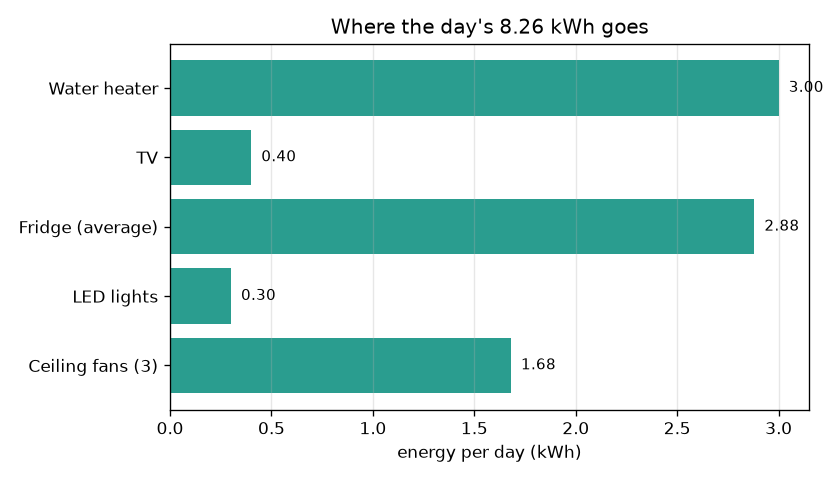
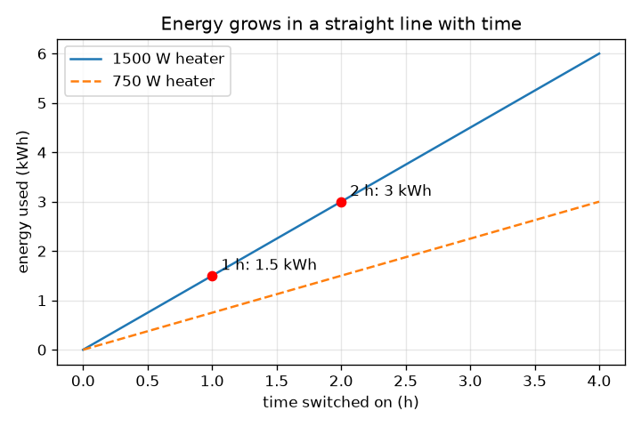

# Session 1: Power times time is energy

*Level 1 (conceptual interactive model) · about 60 minutes · openhousehold*

> This is a simplified educational model. It is not a validated design tool and must not be used for real structures, electrical installations, vehicles, industrial processes or medical decisions.

**Prerequisites**

- Multiplying decimals.
- You have read PRIMER.md and run `python start.py 1` once.

**Learning objectives.** After this session you can:

- Tell power (kW) from energy (kWh) and say what each one measures.
- Use energy = power x time and cost = energy x rate, by hand and in Python.
- Add up the daily energy of a small household and find its biggest user.
- Read a bar chart of energy per appliance and a straight-line graph of energy against time.

## A. Real-world problem
An electricity bill is in 'units'. A 1500 W water heater feels powerful, yet a 100 W TV left on for the whole evening also costs money. Which one matters more? The answer depends on both how strong an appliance is (power) and how long it runs (time). This session gives you the one rule that turns a list of appliances into a number of units and a cost. Education only: a simplified model, not advice about wiring or buying appliances.

## B. Concept and theory
Power is how fast energy is used. Its unit is the watt (W); 1 kilowatt (kW) is 1000 W. Energy is the total used over some time. When power is in kW and time in hours, energy comes out in kilowatt-hours (kWh), the 'unit' on your bill. The cost is the energy times the price per kWh (the rate). Energies of different appliances can simply be added.

| Symbol | Meaning | Unit |
|---|---|---|
| P | power of an appliance | W or kW |
| t | time the appliance is switched on | h |
| E | energy used | kWh |
| r | price of energy (flat, illustrative) | Rs per kWh |
| C | cost | Rs |

**Assumptions**

- Each appliance draws a constant power while it is on.
- The hours per day are the same every day.
- The rate is a single flat number (Session 2 adds slabs).
- The fridge is replaced by its average power, 120 W over 24 h.

$$ E\,[\mathrm{kWh}]=P\,[\mathrm{kW}]\times t\,[\mathrm{h}] $$

$$ E_{\mathrm{day}}=\sum_i P_i\,t_i $$

$$ C=E_{\mathrm{day}}\times r $$

## C. Visual explanation
The first figure is a bar chart of the day's energy by appliance: the heater (3.00 kWh) and the fridge (2.88 kWh) are the biggest users even though the fridge is only 120 W, because it never switches off. The second figure plots heater energy against time on. It is a straight line through the origin; the slope is the power (1.5 kWh per hour for a 1500 W heater). The red dots show 2 hours giving 3 kWh and 1 hour giving 1.5 kWh. The block diagram in the app shows the flow: inputs, energy, house total, cost.

*Energy per appliance per day: the heater and the always-on fridge lead.*

*Energy against time is a straight line; halving the time halves the energy.*

## D. Interactive simulation
Run the lesson (`python start.py 1`), then open the live app: [Session 1: power x time = energy](https://krunalpanchal1995.github.io/openhousehold/session-01/) (or `app.html` in this folder). Change the heater power and hours and watch the bars and the cost change. Switch to the line graph and see that doubling the time doubles the energy.

**Challenge.** Bring the day's cost under Rs 40 while the heater still runs at least half an hour.

## E. Worked example and experiment
**Problem.** A 1.5 kW heater runs for 2 hours. How much energy does it use? What if the time is halved? What does the whole household of the app use per day and what does it cost at Rs 6 per kWh?

1. Heater: E = 1.5 kW x 2 h = 3 kWh.
2. Half the time: E = 1.5 kW x 1 h = 1.5 kWh. Half the time, half the energy.
3. Others: fans 0.21 kW x 8 h = 1.68 kWh; lights 0.06 kW x 5 h = 0.30 kWh; fridge 0.12 kW x 24 h = 2.88 kWh; TV 0.10 kW x 4 h = 0.40 kWh.
4. Total = 1.68 + 0.30 + 2.88 + 0.40 + 3.00 = 8.26 kWh per day.
5. Cost = 8.26 kWh x Rs 6 = Rs 49.56 per day. With the heater at 1 hour the total is 6.76 kWh and Rs 40.56, a saving of Rs 9.00 a day.

**Answer.** The heater uses 3 kWh, or 1.5 kWh if the time is halved. The household uses 8.26 kWh and pays Rs 49.56 per day at Rs 6 per kWh.

**Experiment.** Look at the label on a real appliance, note its power in watts, and use a plug-in energy meter (or the meter on your wall, reading it before and after an hour of use) to measure its energy. Compare with power x time. Real appliances differ from the label: a heater cycles on and off with its thermostat, a fridge compressor runs only part of the time, and the label shows the maximum. The model uses fixed numbers; the meter shows what really happened.

## F. Assessment and design challenge
**Question type A: Conceptual.** Explain the difference between a kilowatt and a kilowatt-hour. Which one does the bill charge for?

Hint

One is a rate, the other is an amount. Think of speed and distance.

Step-by-step solution

A kilowatt is power: how fast energy is being used right now (like speed). A kilowatt-hour is energy: the total used over time (like distance travelled). The bill charges for kilowatt-hours, because a strong appliance used for a few minutes can use less energy than a weak one left on all day.

**Question type B: Numerical.** A 100 W TV runs for 4 hours a day. Find its energy per day and per 30 days, and the cost per 30 days at Rs 6 per kWh. Check that the answer is sensible.

Hint

Convert watts to kW first: divide by 1000.

Step-by-step solution

E = 0.1 kW x 4 h = 0.4 kWh per day. Per 30 days: 0.4 x 30 = 12 kWh. Cost = 12 x 6 = Rs 72. Sanity check: a small appliance used a few hours gives only a few kWh a month, and 12 kWh fits that.

**Question type C: Graph and simulation interpretation.** In the straight-line graph of heater energy against time, what does the slope mean? What happens to the line if you halve the power?

Hint

Slope is rise over run: kWh per hour.

Step-by-step solution

The slope is energy per hour, which is the power in kW (1.5 kWh per hour for 1500 W). Halving the power halves the slope: the line is lower and flatter, so 2 hours gives 1.5 kWh instead of 3 kWh.

**Question type D: Design and optimisation challenge.** Design: the family wants the daily cost under Rs 40 (it is Rs 49.56 now) without giving up hot water entirely. List two changes from the app and check each with a calculation.

Hint

Cost = total energy x 6, so the total must fall below 40 / 6 = 6.67 kWh. You need to cut more than 1.59 kWh.

Step-by-step solution

Need 8.26 - 6.67 = 1.59 kWh or more saved. Option 1: heater 2 h to 1 h saves 1.5 kWh, not quite enough alone (6.76 kWh, Rs 40.56). Add: fans 8 h to 6 h saves 0.42 kWh. New total 6.34 kWh, cost Rs 38.04. Trade-off: less hot water and less cooling. Option 2: a 750 W heater for 2 h gives 1.5 kWh (saves 1.5 kWh too), but it heats the water more slowly, so it may need longer.

Score yourself with [RUBRIC.md](../../RUBRIC.md). Print the [activity sheet](activity_sheet.md) to work on paper.

## Common misconceptions
| Common misconception | What is actually true |
|---|---|
| A bigger-wattage appliance always costs more to run. | Cost depends on power times time. A 100 W TV on for 24 h (2.4 kWh) uses more than a 1500 W heater on for 1 h (1.5 kWh). |
| kW and kWh are the same thing. | kW is how fast energy is used; kWh is the amount used. Multiply kW by hours to get kWh. |
| A fridge costs little because it is only 120 W. | It runs all day, so 0.12 kW x 24 h = 2.88 kWh, almost as much as a 2 hour heater. |

## Glossary
- **power**: how fast energy is used, in watts (W) or kilowatts (kW)
- **energy**: the total amount used over time, in kilowatt-hours (kWh)
- **kilowatt-hour (kWh)**: the energy used by 1 kW running for 1 hour; one 'unit' on a bill
- **rate**: price per kWh
- **load**: an appliance or a group of appliances that uses electricity

## Finish
1. Do the three coding tasks in [exercises.md](exercises.md).
2. Run `python start.py 1` again after your changes. It ends with the checkpoint; when it prints `PASS`, you are done. (Checkpoint only: `python start.py check 1`.)

Next: [Session 2](../session-02/README.md)
