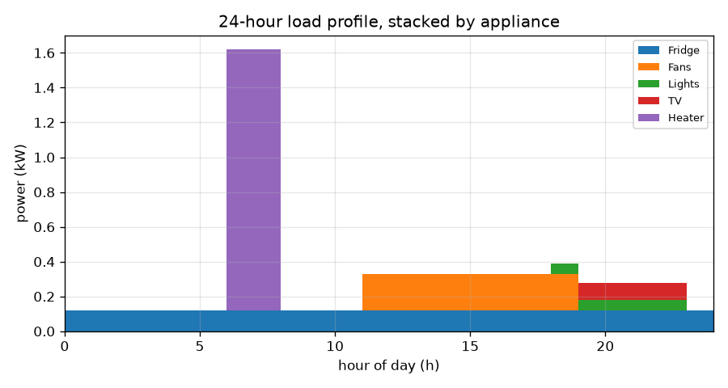
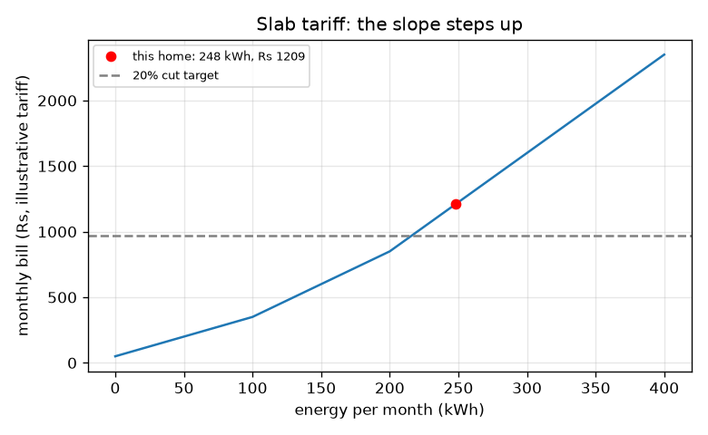

# Session 2: A day of load and a bill with slabs

*Level 2 (mathematical engineering model) · about 75 minutes · openhousehold*

> This is a simplified educational model. It is not a validated design tool and must not be used for real structures, electrical installations, vehicles, industrial processes or medical decisions.

**Prerequisites**

- Session 1: energy = power x time.
- Reading a step graph and a piecewise line graph.

**Learning objectives.** After this session you can:

- Build a 24-hour load profile as the sum of appliance schedules and find its daily energy.
- Compute a bill with slab tariffs and explain the marginal rate.
- Find the peak demand and use the power factor to get apparent power and current.
- Solve an inverse design problem: how much usage must go to cut the bill by 20 percent?

## A. Real-world problem
Two homes can use the same number of units in a month and yet one needs thicker wires and a bigger supply because it switches everything on at the same time. And a bill is rarely 'units times one price': in a slab tariff, the price per unit steps up as you use more. A family wants to cut its bill by 20 percent. How much less must it use? The tariff here is an illustrative teaching tariff, not any real utility's, and this is a simplified model, not an electrical design tool.

## B. Concept and theory
Divide the day into 24 hours. In each hour the home's power is the sum of the powers of the appliances that are on. Because one hour at P kW is P kWh, the daily energy is the sum of the 24 hourly powers. The peak demand is the largest hourly power. The monthly energy is 30 times the daily energy. A slab tariff charges a fixed amount plus a different rate for each band of units: here 3 Rs per kWh for the first 100 kWh, 5 Rs for the next 100 and 7.5 Rs above 200, plus Rs 50 a month. In alternating current, only the real power P does useful work and is billed as energy, but the current also depends on the power factor pf: apparent power S = P / pf (in kVA) and current I = P / (V x pf).

| Symbol | Meaning | Unit |
|---|---|---|
| P(h) | home power in hour h | kW |
| E_day | energy per day | kWh |
| E_m | energy per month (30 days) | kWh |
| P_peak | largest hourly power | kW |
| pf | power factor, 0 to 1 | no unit |
| S | apparent power | kVA |
| V | supply voltage (230) | V |
| I | current at the peak | A |

**Assumptions**

- Every day is the same, and a month has 30 days.
- Appliances run at the same hours every day; the fridge uses its average power.
- The tariff is illustrative: Rs 50 fixed, 3/5/7.5 Rs per kWh in slabs of 100, 100 and the rest.
- A single power factor for the whole home; the bill is for kWh only.
- Wiring and supply limits are not modelled: this is not an installation design.

$$ P(h)=\sum_{i} P_i(h),\qquad E_{\mathrm{day}}=\sum_{h=0}^{23} P(h)\times 1\,\mathrm{h} $$

$$ \mathrm{bill}=50+3\min(E_m,100)+5\min\big(\max(E_m-100,0),100\big)+7.5\max(E_m-200,0) $$

$$ S=\frac{P}{\mathrm{pf}},\qquad I=\frac{P\times 1000}{V\,\mathrm{pf}} $$

## C. Visual explanation
The first figure stacks the appliance powers hour by hour: the fridge is a thin band all day, the fans fill the afternoon, the lights and TV the evening, and the 1.5 kW heater makes a tall block at 6 to 8. The tallest point is the peak, 1.62 kW. The second figure is the monthly bill against the monthly energy: a line that bends upward at 100 and 200 kWh because each slab is dearer. The red dot is this home at 247.8 kWh and Rs 1208.50, and the dashed line is 80 percent of that bill. The app's third view is the power triangle: P, Q and S, with pf = P / S.

*Hourly load stacked by appliance; the heater makes the 1.62 kW peak at 6 to 8.*

*Monthly bill against energy under the illustrative slab tariff; the slope steps up at 100 and 200 kWh.*

## D. Interactive simulation
Run the lesson (`python start.py 2`), then open the live app: [Session 2: load profile and slab bill](https://krunalpanchal1995.github.io/openhousehold/session-02/) (or `app.html` in this folder). Move the heater start and duration, and the other-loads slider. Watch the profile, the bill dot on the slab curve and the peak. Then open the power triangle and change the power factor.

**Challenge.** Cut the monthly bill by at least 20 percent (to about Rs 967 or less).

## E. Worked example and experiment
**Problem.** With the heater on from 6:00 for 2 hours, find the daily energy, the monthly energy, the monthly bill, the peak demand, and the current at the peak for pf 0.9 on 230 V.

1. Daily energy: fridge 2.88 + fans 1.68 + lights 0.30 + TV 0.40 + heater 3.00 = 8.26 kWh.
2. Monthly energy = 30 x 8.26 = 247.8 kWh.
3. Slab bill: 50 + 100 x 3 + 100 x 5 + (247.8 - 200) x 7.5 = 50 + 300 + 500 + 358.5 = Rs 1208.50.
4. Peak: in hours 6 and 7 the fridge (0.12 kW) and heater (1.5 kW) are on: 1.62 kW.
5. At pf 0.9: S = 1.62 / 0.9 = 1.80 kVA and I = 1620 / (230 x 0.9) = 7.83 A.

**Answer.** 8.26 kWh per day, 247.8 kWh per month, a bill of Rs 1208.50, a peak of 1.62 kW (1.80 kVA, 7.83 A).

**Experiment.** Read your own meter at the same time each day for a week (or use a plug-in meter on one appliance) and compare the weekly energy with the model. Differences come from thermostats and compressors cycling, appliances used on some days only, standby power, and a real tariff that differs from this teaching one. The model has fixed schedules; real homes do not.

## F. Assessment and design challenge
**Question type A: Conceptual.** Why can two homes with the same monthly kWh have different peak demand? Why does the peak matter even though the bill is only for kWh?

Hint

Think of one home that switches on everything at once and one that spreads the use.

Step-by-step solution

Energy adds up power over time, the peak is the highest power at one moment. A home that runs the heater, iron and cooler together has a high peak; one that staggers them has the same energy but a lower peak. The peak decides the current in the wires and the size of the supply, which must not be exceeded, even though the bill only counts kWh.

**Question type B: Numerical.** A home uses 150 kWh in a month. Find its bill with the slab tariff and its average price per kWh. Check that the answer is sensible.

Hint

50 fixed, 100 kWh at 3, then 50 kWh at 5.

Step-by-step solution

Bill = 50 + 100 x 3 + 50 x 5 = 50 + 300 + 250 = Rs 600. Average = 600 / 150 = Rs 4 per kWh, between the first slab rate (3) and the second (5), plus the fixed charge. Sensible.

**Question type C: Graph and simulation interpretation.** On the bill graph, how much more does 10 extra kWh cost at 250 kWh than at 50 kWh? Why?

Hint

Read the slope (the marginal rate) of the curve at each point.

Step-by-step solution

At 50 kWh the slope is 3 Rs per kWh, so 10 kWh costs Rs 30. At 250 kWh the slope is 7.5 Rs per kWh, so 10 kWh costs Rs 75. The curve gets steeper at 100 and 200 kWh because each slab has a higher rate, so saving the last units saves the most money.

**Question type D: Design and optimisation challenge.** Design: cut the monthly bill from Rs 1208.50 by 20 percent. Find the heater time needed if nothing else changes, then find a second plan that also cuts the fans, lights and TV by 20 percent. State the energy cut each needs and the trade-offs.

Hint

The target bill is Rs 966.80, which is in the top slab: 850 + 7.5 x (E - 200) = 966.80. Use heater_hours_for_bill.

Step-by-step solution

Target E_m = 200 + 116.8 / 7.5 = 215.57 kWh, i.e. 7.186 kWh per day, a cut of 1.07 kWh per day (13.0 percent of the energy). Plan 1: heater from 2 h to 1.28 h (about 1 h 17 min). Plan 2: other loads at 80 percent saves 0.476 kWh per day, so the heater may run 1.60 h (about 1 h 36 min). Cutting the other loads alone saves only 8.9 percent of the bill (Rs 1101.40). Trade-off: shorter hot-water time or less cooling and light. The bill falls 20 percent for only a 13 percent energy cut because the saved units come from the dearest slab.

Score yourself with [RUBRIC.md](../../RUBRIC.md). Print the [activity sheet](activity_sheet.md) to work on paper.

## Common misconceptions
| Common misconception | What is actually true |
|---|---|
| The bill is energy times one price. | With slabs the price per kWh depends on how much you use; the last units cost the most. |
| Peak demand and energy are the same thing. | Peak is the highest power at one moment (kW). Energy is power summed over time (kWh). They are different, and the peak matters for wires, not for the kWh charge. |
| A lower power factor means more energy is used and billed. | The home bill counts real energy in kWh. A low power factor raises the current for the same real power (I = P / (V pf)), which stresses wiring. |

## Glossary
- **load profile**: the home's power plotted against the hour of the day
- **peak demand**: the largest power the home draws at one moment
- **slab tariff**: a price list where the rate per kWh changes with the amount used
- **marginal rate**: the price of the next unit; the slope of the bill curve
- **power factor**: real power divided by apparent power, between 0 and 1
- **apparent power**: voltage times current, in kVA; at least as large as the real power in kW

## Finish
1. Do the three coding tasks in [exercises.md](exercises.md).
2. Run `python start.py 2` again after your changes. It ends with the checkpoint; when it prints `PASS`, you are done. (Checkpoint only: `python start.py check 2`.)

Next: [Session 3](../session-03/README.md)
