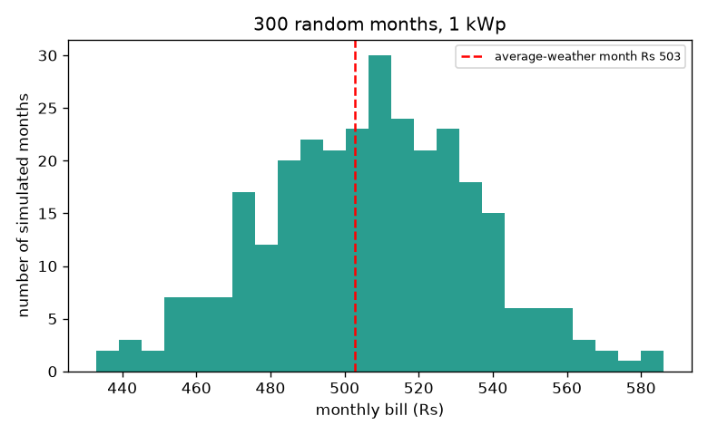
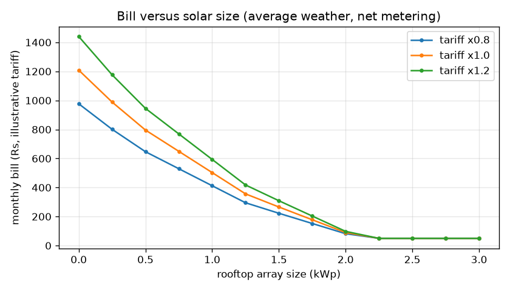
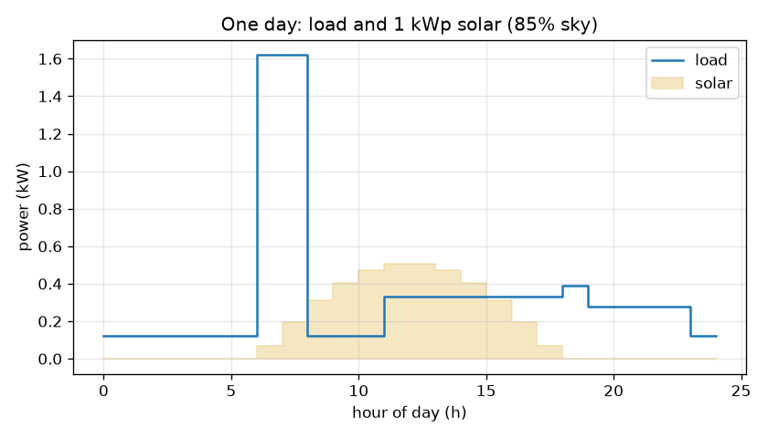

# Session 3: A month with random usage and rooftop solar

*Level 3 (simulation and validation) · about 90 minutes · openhousehold*

> This is a simplified educational model. It is not a validated design tool and must not be used for real structures, electrical installations, vehicles, industrial processes or medical decisions.

**Prerequisites**

- Session 1: energy = power x time.
- Session 2: load profile and slab bill.
- A sine curve (sin of an angle).

**Learning objectives.** After this session you can:

- Simulate 30 days with random heater time, random habits and random cloud cover.
- Model rooftop solar as a half sine and apply net metering hour by hour.
- Validate the simulation against a hand calculation and against the exact area under a sine.
- Test sensitivity to array size, tariff and usage, and recognise the limit where the bill floors.

## A. Real-world problem
A family is thinking about a rooftop solar array. Will it cut the bill? By how much? Weather and habits change every day, so one number cannot be exact. We simulate a whole month many times, subtract the sun's power hour by hour, and ask how the bill responds to the size of the array, the tariff and the usage. And we check the simulation against a calculation by hand, so we know when to trust it. This is general education with an illustrative tariff, not a quotation or a design for any real installation.

## B. Concept and theory
Each day the load is the Session 2 profile, but the heater time is multiplied by a random factor between 0.5 and 1.5 and the other habits by a random factor between 0.8 and 1.2. Solar generation is a half sine between 6:00 and 18:00 with peak power kWp x derate, scaled by a random cloud factor (average 0.85). Derate (0.6) lumps together heat, wiring, inverter and dust losses. Each hour the home imports energy if the load exceeds the solar power and exports if it is lower. With net metering the month is billed on imports minus exports, never below zero (extra credit is carried forward, not paid out, in this model). Without export credit the bill is based on imports only.

| Symbol | Meaning | Unit |
|---|---|---|
| kWp | peak rating of the array | kW |
| derate | fraction of the rating actually delivered (0.6) | no unit |
| c | cloud factor of the day | no unit |
| G(h) | solar power in hour h | kW |
| L(h) | home load in hour h | kW |
| Imp, Exp | monthly imported and exported energy | kWh |
| N | net energy billed | kWh |

**Assumptions**

- Solar is a half sine from 6:00 to 18:00, evaluated at the middle of each hour.
- The derate 0.6 and the cloud statistics are illustrative.
- Net metering without payment for extra credit; the tariff is the illustrative slab tariff of Session 2.
- Random factors are independent from day to day and uniform or normal as stated.
- No battery, no inverter limits, no seasons; not a design or financial tool.

$$ G(t)=\mathrm{kWp}\cdot d\cdot c\cdot\sin\!\left(\frac{\pi (t-6)}{12}\right),\quad 6<t<18 $$

$$ \mathrm{Imp}=\sum \max(L-G,0),\quad \mathrm{Exp}=\sum \max(G-L,0),\quad N=\max(\mathrm{Imp}-\mathrm{Exp},0) $$

$$ \sum_{k=0}^{11}\sin\frac{(k+1/2)\pi}{12}=\frac{1}{\sin(\pi/24)}=7.661\ \approx\ \int_6^{18}\sin\frac{\pi(t-6)}{12}\,dt=\frac{24}{\pi}=7.639 $$

## C. Visual explanation
The first figure is one day: the load as steps and the sun as a golden bump from 6 to 18. The heater block at 6 to 8 sits before the sun, so it is bought from the grid, while the afternoon solar surplus is exported. The second figure plots the monthly bill against array size for three tariffs: the bill falls steeply at first, flattens as the net energy drops into cheaper slabs, and reaches the fixed Rs 50 around 2.1 kWp. The third figure is a histogram of 300 random months for a 1 kWp array: the bills cluster near Rs 507 with a spread of about Rs 28. In the app, the Sankey-style flow view shows the average day: solar split into used and exported, plus grid import.

*300 random months for a 1 kWp array: the average-weather month sits in the middle.*

*Monthly bill against array size for three tariffs: steep at first, flat at Rs 50.*

*One day: the heater runs before the sun; the afternoon solar surplus is exported.*

## D. Interactive simulation
Run the lesson (`python start.py 3`), then open the live app: [Session 3: rooftop solar and net metering](https://krunalpanchal1995.github.io/openhousehold/session-03/) (or `app.html` in this folder). Raise the array size and watch the flow view: the grid import band shrinks and the export band grows. Open the sensitivity graph and move the tariff and usage sliders.

**Challenge.** Get the monthly net-metering bill to Rs 350 or less with a roof that takes at most 1.5 kWp, with usage and tariff unchanged at 100 percent.

## E. Worked example and experiment
**Problem.** With a 1 kWp array, average weather (cloud 0.85, no random change) and the Session 2 household, find the net energy and the monthly bill by hand and compare with the simulation.

1. Sun energy per kWp per day without clouds: derate x sum of 12 midpoint sines = 0.6 x 7.661 = 4.597 kWh.
2. With cloud 0.85: 4.597 x 0.85 = 3.907 kWh per day, so 117.2 kWh in 30 days.
3. Net per day = load - generation = 8.26 - 3.907 = 4.353 kWh, so net per month = 130.6 kWh (the hourly import of 172.4 kWh minus the export of 41.8 kWh).
4. Bill: 50 + 100 x 3 + (130.6 - 100) x 5 = 50 + 300 + 153.0 = Rs 503 (Rs 502.9 with unrounded numbers).
5. Compare: no panels Rs 1208.50; without export credit Rs 711.9.

**Answer.** Net energy 130.6 kWh and a monthly bill of about Rs 503, against Rs 1208.50 without solar. The checkpoint reproduces both numbers from the simulation.

**Experiment.** If a neighbour has rooftop solar, ask (with permission) for the generation figures of one sunny and one cloudy day, and compare them with the half-sine shape and the 0.6 derate. Real output rises and falls with cloud, the sun's angle through the year, panel temperature and dust, and it is not exactly sine-shaped. The model gives the right order of magnitude and direction, not the exact number.

## Real-world application and mini-project: Audit your own home and propose three changes
Make a list of the appliances in your home (or a relative's home, with permission): read the power in watts from the label or manual, estimate the hours of use per day, and write down the units (kWh) on one recent electricity bill. Use Session 2's functions to predict the month, compare with the bill, and propose three changes (shorter use, a different time of day, a more efficient appliance, or a rooftop array from Session 3). Do not open appliances or touch wiring; read labels and bills only. This is an education exercise, not an energy-audit certificate or financial advice.

**Deliverable:** A script that prints a table of appliance, power, hours, kWh per month, share of the total, then the predicted and billed kWh, and the saving in kWh and rupees of each of your three proposals, plus a one-paragraph write-up of why model and bill differ.

**Success looks like:** The predicted monthly kWh is within 15 percent of the billed kWh, and each proposal shows its saving worked out with your own tariff.

## F. Assessment and design challenge
**Question type A: Conceptual.** Why does the bill with net metering fall by less and less for each extra half kWp of panels?

Hint

Think about which slab the saved units come from.

Step-by-step solution

The first panels cut units that would be billed at the top rate (7.5), the next ones cut units from the 5 Rs slab, then the 3 Rs slab. The same saved kWh is worth less each time, so the bill curve flattens, and at about 2.1 kWp it reaches the fixed charge.

**Question type B: Numerical.** Find the monthly net energy and the net-metering bill for a 1.5 kWp array in average weather (cloud 0.85). Check the result with the simulation.

Hint

Generation per day = 1.5 x 0.6 x 0.85 x 7.661.

Step-by-step solution

Gen = 1.5 x 0.6 x 0.85 x 7.661 = 5.861 kWh per day. Net per day = 8.26 - 5.861 = 2.399 kWh, so 72.0 kWh per month. Bill = 50 + 72.0 x 3 = Rs 265.9 (all in the first slab). Units: kWh and Rs. Sensible: it is below the Rs 502.9 of the 1 kWp array.

**Question type C: Graph and simulation interpretation.** On the bill-versus-size graph, read the bill at 0, 1, 2 and 3 kWp, and explain why the last two points are so close.

Hint

At 2 kWp the net energy is only 13 kWh; at 3 kWp it is negative.

Step-by-step solution

About Rs 1208.5, 502.9, 90.1 and 50.0. At 3 kWp the net energy is negative (-103.9 kWh), but credit is not paid out, so the bill is just the fixed Rs 50. Extra panels beyond about 2.1 kWp do not reduce the bill any more in this model.

**Question type D: Design and optimisation challenge.** Design: with a roof for at most 2 kWp, choose the smallest array (in steps of 0.5 kWp) that gives a bill of Rs 350 or less in average weather, then check it in a bad month (cloud 0.6). If exports earned nothing, would the answer still work?

Hint

Compute the bill for 1.0, 1.5 and 2.0 kWp as in Section E, then repeat with cloud 0.6.

Step-by-step solution

1.0 kWp gives Rs 502.9 (too high); 1.5 kWp gives Rs 265.9 (ok). In a bad month with cloud 0.6, 1.5 kWp gives a net of 123.7 kWh and Rs 468.4, above the target, while 2 kWp gives Rs 296.9. So choose 2 kWp for a safe margin, or 1.5 kWp if the occasional bad month is acceptable. If exports earn nothing, the 1.5 kWp bill is Rs 669.7 (imports 163.9 kWh), so the goal is missed: the answer depends strongly on the net-metering rule. Trade-off: cost of panels against the saving and the weather risk.

Score yourself with [RUBRIC.md](../../RUBRIC.md). Print the [activity sheet](activity_sheet.md) to work on paper.

## Common misconceptions
| Common misconception | What is actually true |
|---|---|
| A 1 kWp array gives 1 kW all day. | Output follows the sun: a half sine, with a peak below the rating (derate 0.6 here), and zero at night. |
| Solar always cuts the bill in proportion to its size. | The saving per kWp falls as the net energy falls into cheaper slabs, and it stops once the net is zero. |
| Averaging a random simulation is the same as one run. | One random month differs from the average (spread about Rs 28 here). Many runs show the typical value and the spread. |

## Glossary
- **kWp**: kilowatt-peak, the rating of a solar array under standard test conditions
- **derate**: the fraction of the rating actually delivered after losses
- **net metering**: billing on imported minus exported energy over the month
- **import / export**: energy taken from the grid / sent to the grid
- **sensitivity**: how much an output changes when one input changes
- **Monte Carlo**: running a random simulation many times to see the typical result and the spread

## Finish
1. Do the three coding tasks in [exercises.md](exercises.md).
2. Run `python start.py 3` again after your changes. It ends with the checkpoint; when it prints `PASS`, you are done. (Checkpoint only: `python start.py check 3`.)

Next: the [roadmap](../../promo/roadmap.md). Session 4 is yours to build.
